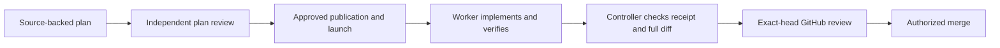

# How the SDLC system protects verification

The SDLC skills connect requirements, implementation, tests, and review. Their aim is evidence that the requested behavior works. A green test command alone does not establish that.

## Roles and authority



Planning inspects source and defines acceptance criteria, required behavior, and verification boundaries. Plan review checks those requirements independently. Publication and launch require the applicable authorization. Planning or review alone grants no external write authority.

During delivery, one Worker owns product changes, tests, local commits, and corrections. The Controller owns lifecycle state and decides whether the returned evidence satisfies the canonical issue contract. The Controller must inspect the evidence and full diff rather than adopt the Worker's conclusion.

Standard and large changes use guarded local Codex review. Trivial changes use an inline audit. Any detected or declared verification-file change requires at least standard local review. The Controller independently checks that minimum. Consequence may require a higher tier.

If correction first promotes an inline-reviewed unit to standard, the Controller pins a compatible runtime and assigns that unit's first guarded Codex review to the same Worker. The original inline evidence is retained. This exception does not permit repeated general reviews after valid Codex coverage exists.

## What makes a useful test

The shared [test-quality contract](test-quality.md) governs planning, plan review, delivery, and correction. Each proposed test identifies the behavior, public interface or stable seam, expected-result source, plausible incorrect result it rejects, baseline, fixture strategy, and additional protection.

Expected results come from approved requirements, an authoritative contract, or independent reasoning. Running the implementation and copying its answer does not establish correctness. A characterization test may preserve observed behavior when it labels that limitation. Contract-backed properties can be valid oracles, but broad bounds do not replace a required exact outcome.

Changed behavior should have a meaningful failure against prior behavior when practical, then a passing result. Setup, import, or syntax failures do not show that a behavioral assertion works. Refactors use before-and-after passing checks. When a meaningful failing baseline is unavailable, record why and the alternative proof. Mechanical or documentation changes use proportionate checks.

## Changes to existing verification

Never remove or weaken verification solely to obtain green results. This includes assertions, expectations, test discovery, skips and focused tests, snapshots, fixtures, test configuration, and CI commands.

An approved requirement can legitimately change an expectation or retire a test. Record the authoritative reason and retained or replacement proof. Required call counts, logs, and other observable effects remain valid contracts when they describe product behavior. Production code must not recognize test fixtures merely to satisfy assertions.

When the intended contract is unresolved, stop the affected change and report:

```text
TEST CONFLICT: <file>:<line> <reason>
```

Use the existing stopped outcome with that reason and a concrete next action. Do not invent a successful receipt or alter the expectation to match a bug. Continue safe independent work where the current workflow permits it. Locally correctable implementation defects stay with the Worker.

## Instruction delivery

Copy the complete [Code Review Rules template](templates/agents-code-review-rules.md) into a product repository's root AGENTS.md. Preserve the version marker and six core rules; append repository-specific checks. Nested AGENTS.md files can add rules near the code they govern.

CDL preflight checks the root file before network-backed launch inspection. It requires a real Code Review Rules section, the supported contract version, and the complete canonical core rules outside fenced examples. A heading or marker alone fails. It reports the governing path and remediation without editing the product repository. Candidate finalization and Controller acceptance recheck the root contract so a delivery cannot remove it silently.

Commented, indented, fenced, and raw HTML code/pre/listing or raw-text examples do not supply governing rules. Fences close only with a matching character, a sufficiently long run and a spaces/tabs-only suffix. A separate complete section outside those examples remains valid; inline code and escaped literal tag mentions do not hide it.

This check establishes structural presence. It does not prove that a model read or followed a rule. [OpenAI documents](https://learn.chatgpt.com/docs/third-party/github#customize-what-codex-reviews) applicable repository AGENTS.md guidance and review-request comments for one-off focus. PR and issue bodies are not a verified delivery mechanism for linked review instructions. The current request helper supports a bare review request plus its tracking marker, so custom request text remains a follow-up.

Local review currently receives a Worker-prepared brief. ADR 0005 proposes stock review without that brief; this change does not resolve the difference. The brief is evidence supplied to a reviewer, not independent proof of the Worker's claims.

## Receipt checks

A ready-to-push receipt uses schema version 2. The Worker finalizer and Controller verifier both reject version 1 with a fresh-receipt instruction. Do not relabel an old receipt as version 2 or reconstruct it in the Controller. Affected runs need a fresh Worker packet and evidence appropriate to the current state. Installation or version changes require coordinated fresh runs under the repository's release policy.

Legacy Claude audit metadata stays readable and immutable as history, but does not satisfy fresh nontrivial schema-2 acceptance. Finish or stop an old run before adopting the new skills, then begin an authorized fresh run with a current packet and initial Codex review. This is not permission to rerun general review inside an old run. Valid existing Codex audits still cover descendant corrections by verified ancestry.

Each acceptance, risk, test, local-review, or correction-check entry has:

- a nonblank claim and required versus exercised boundary;
- the exact command and a terminal result, or an explicit not-run reason;
- bounded references to nonempty regular files within the checkout.

The validators check types, result consistency, reference containment and line ranges, receipt size, hash, clean checkout, branch, and exact candidate commit. They never execute referenced content. Use ignored checkout-local evidence files for output and sanitized contract excerpts. Do not copy secrets, private payloads, or sensitive customer data into evidence.

Ordinary evidence files are limited to 1 MiB. Guarded references use `kind: "guarded-audit"` and receive verified transcript/receipt hashes, pinned runtime, guarded command, audited tree and candidate ancestry at every size; Controller acceptance also binds its recorded audit path, head, brief hash and exit result. A nontrivial implementation needs this proof in passed localReview evidence, alongside any ordinary supporting references. Trivial inline evidence remains ordinary, and correction keeps original ancestor-audit reuse without a new general review. Small audits require the kind marker; existing unmarked references over 1 MiB still infer guarded verification. Guarded audits directly under the real `sdlc-scratch/audits/` directory may be up to 128 MiB plus 64 KiB, the shared bound for two 64 MiB captured streams and receipt metadata. Arbitrary large evidence has no exception. Per-call metadata caches avoid duplicate audit work while preserving stronger-role promotion and all requested range checks.

Structured production-surface census and closure objects keep their existing fields. The verifier checks their identifiers and relationships. Valid structure does not establish that a claimed inventory is complete or a test exercised that surface.

## Reconciling the full diff

Both packet phases carry a Controller-approved base ref and full SHA. The finalizer derives the candidate merge base from that approved SHA. The Controller independently derives it from its own target ref. A receipt-supplied base cannot substitute for either check.

Git supplies the complete base-to-candidate changed-file list. Renames are treated as a deletion and addition. A conservative detector identifies conventional test, spec, fixture, snapshot, package/runner, hook, and CI paths, including all local-action definitions and supporting files under `.github/actions/`. Each detected file needs exactly one matching verification-change disposition with its status, reason, contract references, and passing retained or replacement proof. Additional declared paths must occur in the same diff. Any such path requires at least standard review.

The Controller also inspects the complete changed-file list for verification hidden behind custom naming or scripts. It requires missing dispositions before acceptance. Detection is based on paths, not a universal parser for every test framework. It cannot prove that an assertion was weakened, an expected value is independent, or a cited contract is authoritative.

## Boundaries and adoption

Hashes bind recorded content to state. They do not prove commands ran, expected results are correct, references are truthful, or behavioral coverage is sufficient. Controller semantic review and independent review remain necessary. GitHub severity and local confidence/readiness are separate judgments.

Runtime tests exercise rejection and valid exceptions through preflight, the Worker finalizer, and the Controller verifier. Synthetic decision scenarios test bounded decisions separately. Proposed actions are not counted as executed actions, and passing a subset is reported as partial. Neither test set proves live delivery behavior.

Source changes and exports do not activate skills. Keep active workflows fixed, review changes before adoption, and coordinate upgrades after affected runs finish. Product repositories need the root review contract before using the stricter CDL preflight. This change does not modify product repositories or install anything.

Deferred safeguards include a CI test-diff check with a human label, CODEOWNERS for tests and CI, a read-only-test sandbox profile, ADR 0008's Controller-owned QA agents, the ADR 0005 review-brief decision, richer one-off review requests, independent test-authorship pilots, reusable handoff contracts, and selective mutation/property-testing tooling.
